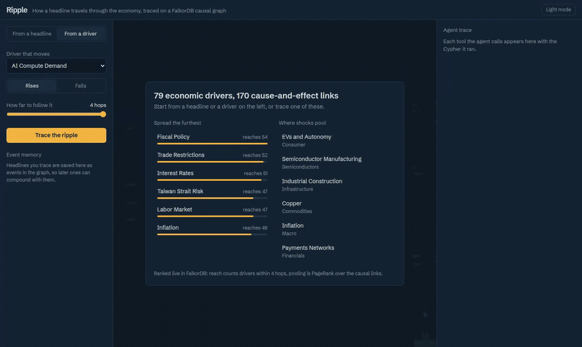
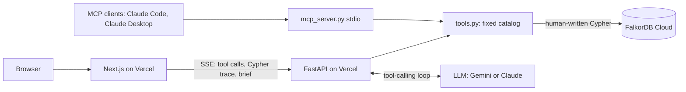
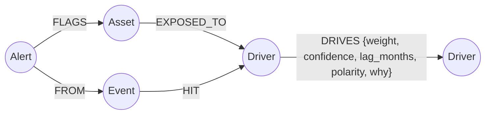

# Ripple

A headline lands. Ripple traces how it moves through the economy on a FalkorDB causal graph, hop by hop, with lags and signs, and says which assets are exposed and why. Every claim in the answer is backed by a path the database returned, and the model never writes Cypher.



Demo video: (link coming)

Built for Graph Hacks (WeMakeDevs x FalkorDB), Track 01: Agents That Act on Connected Data.

- Live app: https://ripple-beta-five.vercel.app
- API: https://ripple-api.vercel.app (FastAPI on Vercel, FalkorDB Cloud on AWS us-east-1)

Not investment advice. Ripple describes exposure in a hand-built graph; it does not predict prices.

## What it does

Two modes:

- **From a driver.** Pick a driver such as `AI_Compute_Demand`, a direction (up or down) and a depth of 1 to 4 hops. A deterministic engine runs one Cypher traversal and returns affected drivers, exposed assets, and the exact path to each. No LLM involved.
- **From a headline.** Type a headline. An LLM agent picks tools from a fixed catalog, the tools run human-written Cypher, and the agent writes a short brief. It then files an Event and an Alert back into the graph. The provider is switchable with `RIPPLE_PROVIDER` (`gemini` or `anthropic`).

There is also a **compare** button: it asks the same model the same headline with no graph and no tools, so you can see what the graph adds.

### Depth 1 vs depth 4

The depth slider is the main demo. Shock `AI_Compute_Demand` and follow it one hop: you get the obvious neighbours. Follow it four hops and `Nuclear_Energy` shows up through a chain nobody typed in:

`AI_Compute_Demand -> Data_Centers -> Electricity_Demand -> Power_Generation -> Nuclear_Energy`

At depth 1, `Nuclear_Energy` is not reached. This is asserted in `tests/test_parity.py`. Depth is set by the user in the UI; the agent's `depth` argument is overwritten in `Run.call`, so the model cannot quietly pick a shallow answer.

## How it maps to the judging criteria

| Criterion | Where it is |
|---|---|
| FalkorDB is load-bearing | The causal model, asset exposure, event memory, alerts, full-text entity search, PageRank and shortest paths all live in and run on FalkorDB. Without it there is nothing to reason over. |
| Model never writes Cypher | `ripple/queries.py` holds every query. The model picks one of 6 tools and fills typed parameters (`ripple/tools.py`). |
| Entity validation | Every tool that takes a driver id checks it against the graph (`RESOLVE_EXACT`). An unknown id raises `ToolError` and the answer type becomes `unknown_entity`. The brief is also scanned: any ticker or driver name the graph did not return this run causes the brief to be replaced by a graph-derived one. |
| Paths returned by the query | `PROPAGATE` returns `[n IN nodes(p) | n.id] AS path` for each traversal. Paths shown in the UI are those rows, not model prose. |
| Memory as graph nodes | `Event` and `Alert` nodes with `HIT`, `FROM` and `FLAGS` edges. `recall_events` reads them back to detect compounding pressure. |
| Graph algorithms as tools | `systemic_drivers` calls `algo.pageRank`; `explain_link` calls `algo.SPpaths`. |
| Depth-1 vs depth-4 demo | See above. |
| Honest "not in graph" | A headline with no plausible driver gets `not_in_graph`, not a guess. Try the sample "Taylor Swift announces a new world tour". |
| MCP | `python -m ripple.mcp_server` exposes the same tool catalog to any MCP client. See [docs/mcp.md](docs/mcp.md). |
| FalkorDB Cloud deploy | The live API runs against FalkorDB Cloud (AWS us-east-1). |

## Architecture



- `ripple/queries.py`: every Cypher string.
- `ripple/engine.py`: propagation and asset scoring (no LLM).
- `ripple/tools.py`: the tool catalog (`SPEC` schemas + `FUNCS`), input validation.
- `ripple/agent.py`: the tool loop for Gemini and Claude, the brief guard, answer types.
- `ripple/db.py`: connection plus `TracedGraph`, which logs every query (name, params, rows, ms) so the UI can show the Cypher that ran.
- `ripple/app.py`: HTTP API. `/api/analyze` streams events over SSE; `/api/ripple` is the no-LLM engine; also `/api/graph`, `/api/systemic`, `/api/events`, `/api/compare`, `/api/health`.
- `ripple/mcp_server.py`: MCP server generated from the same `SPEC` and `FUNCS`.
- `web/`: Next.js UI with the graph drawn using React Flow and ELK layout.

## Graph schema



| Label | Properties |
|---|---|
| `Driver` | `id`, `name`, `theme`, `type`, `description`, `factors`, `aliases` (full-text indexed) |
| `Asset` | `ticker`, `type` (equity, etf, commodity) |
| `Event` | `id`, `headline`, `at`, `direction`, `url` |
| `Alert` | `id`, `text`, `at`, `answer_type` |

Seeded size: 79 `Driver` nodes, 170 `DRIVES` edges (38 with negative polarity), 357 `Asset` nodes, 483 `EXPOSED_TO` edges. `Event` and `Alert` nodes are created at run time.

### The propagation query

This is the core query, verbatim from `ripple/queries.py`. `MAX_DEPTH` is 4. FalkorDB does not accept a parameter in a variable-length bound, so the cap is a literal and the user's depth is applied in the `WHERE`.

```cypher
MATCH p = (s:Driver)-[:DRIVES*1..4]->(t:Driver)
WHERE s.id IN $sources AND length(p) <= $depth
WITH p, t,
     reduce(x = 1.0, r IN relationships(p) | x * r.weight * r.confidence) AS strength,
     reduce(l = 0, r IN relationships(p) | l + r.lag_months) AS lag,
     reduce(sg = 1, r IN relationships(p) | sg * r.polarity) AS sign
WHERE strength >= $min_strength
RETURN t.id AS node, strength, lag, sign, [n IN nodes(p) | n.id] AS path
```

Strength is the product of `weight * confidence` along the path, lag is the sum of edge lags in months, and sign is the product of polarities. `engine.py` sums strength over all paths into a node (`impact`) and sums signed strength (`net`). The strongest single path is kept as the displayed path. Asset score is the summed impact of the drivers it is exposed to, divided by how many drivers it is exposed to, times a type weight (equity 1.0, commodity 0.9, ETF 0.6).

## Tool catalog

The model sees these six tools and nothing else. Parameters are validated by JSON schema (`additionalProperties: false`) and again against the graph.

| Tool | What it does | Cypher it runs |
|---|---|---|
| `search_drivers` | Full-text search over driver names, descriptions, factors and aliases; returns candidate ids | `RESOLVE_FULLTEXT` (`db.idx.fulltext.queryNodes`) |
| `analyze_impact` | Propagate a shock from 1 to 4 driver ids; returns affected drivers and exposed assets with paths, strengths, lags | `RESOLVE_EXACT`, `PROPAGATE`, `EXPOSED_ASSETS` |
| `recall_events` | Past events in the last N days that hit the same drivers (memory) | `RESOLVE_EXACT`, `RECALL_EVENTS` |
| `explain_link` | Shortest causal path between two drivers, or "no path" | `RESOLVE_EXACT`, `EXPLAIN_LINK` (`algo.SPpaths`) |
| `systemic_drivers` | Where shocks pool (PageRank) and which drivers reach the most others within 4 hops | `SYSTEMIC_PAGERANK` (`algo.pageRank`), `SYSTEMIC_REACH` |
| `record_alert` | Write: save the headline as an `Event` and file an `Alert` flagging tickers | `RESOLVE_EXACT`, `RECORD_EVENT`, `CREATE_ALERT` |

The agent loop is limited to 8 turns. `record_alert` is the only tool that writes.

## Answer types

Set in `Run.answer_type` (`ripple/agent.py`):

- `answered`: the graph produced an impact analysis and no earlier events touched the same drivers.
- `compounding`: same, and `recall_events` found earlier events on the same drivers, so pressure is building.
- `not_in_graph`: no driver was plausibly moved; the agent did not call `analyze_impact` and says so.
- `unknown_entity`: a tool rejected a driver id that is not in the graph, and no analysis followed.

## MCP

```bash
claude mcp add ripple -- $(pwd)/.venv/bin/python -m ripple.mcp_server
```

Same six tools, same Cypher, results returned as JSON with the list of queries that ran. Config for Claude Desktop and notes are in [docs/mcp.md](docs/mcp.md). `record_alert` mutates the graph, so clients should confirm before calling it.

## Backtest

Full write-up with per-event tables and caveats: [eval/RESULTS.md](eval/RESULTS.md). Not investment advice.

Setup: the graph as frozen on 2026-01-21 (30 nodes, 46 edges, no polarity, so every edge is +1), 10 real events from 2026-01-29 to 2026-08-06 with the rules fixed before any return was computed. For each event Ripple picked its top 5 priceable tickers with a direction. Score is direction x (ticker return minus SPY return) from the event-day close.

| Metric | 5 trading days | 20 trading days |
|---|---|---|
| Ripple hit rate (50 picks) | 50.0% | 70.0% |
| Random baseline hit rate | 50.1% | 48.9% |
| Ripple mean signed excess return | -1.4% | +4.3% |
| Random baseline mean signed excess | -0.1% | -0.4% |
| Events with positive mean (of 10) | 6 | 8 |
| Share of 200 random seeds at least as good | 91.5% | 2.0% |

Read it honestly:

- At 5 days there is no edge. Hit rate matches random and the mean is negative.
- At 20 days Ripple beat 98% of random seeds. That is a descriptive percentile, not a p-value. Picks within an event are correlated and the events cluster (3 AI-capex, 3 oil, 2 copper), so the effective n is closer to 10.
- The 20-day mean is driven by a few large moves (energy majors, semiconductor equipment) offset by one large loss (the Micron memory event). "8 of 10 events positive" is the sturdier summary.
- The random baseline is weak: it ignores that Ripple only picks assets exposed to the event driver. A fairer baseline, such as buying the source driver's sector ETF, was not run.
- No costs, slippage or short borrow. Hindsight in event selection cannot be excluded.

## Limitations

- **Hand-built graph.** Weights, confidences, lags and polarities are one author's judgment. The calls I am least sure about are listed in [docs/graph_review.md](docs/graph_review.md), for example Lithium and Copper pointing at EVs as input cost (negative) and `Natural_Gas_Price` mixing Henry Hub and TTF.
- **The graph is a DAG.** That blocks feedback loops (rates do not feed back into inflation), and there is no generic GDP node.
- **Impact can exceed 1.0.** Impact sums over parallel paths, so a downstream node can score higher than the shocked node. The displayed path is the strongest single path, while direction comes from the net signed sum, so they can disagree in rare cases.
- **No per-asset polarity.** An asset inherits the direction of the driver it is exposed to. Some drivers therefore carry no assets.
- **Some stale tickers** on original nodes (delisted or renamed) are listed in the graph review.
- **Small backtest**, described above.
- **FalkorDB Cloud free tier has no persistence.** The API checks the graph on startup and reseeds it if empty (`ensure_seeded`), so recorded events and alerts can be lost when the instance restarts.
- **Gemini free tier rate limits** can make "From a headline" fail or slow down under load. "From a driver" does not use an LLM.

## Data provenance

The causal graph data originates from my earlier project, Orion (authored January 2026). During the hackathon I expanded and reviewed it (44 to 79 nodes, 66 to 170 edges, polarity and a `why` sentence on every edge, aliases on every node). All code in this repository was written during the event. To check that moving the logic into Cypher changed nothing, `tests/test_parity.py` compares the FalkorDB engine against a copy of Orion's original Python propagation (`tests/reference_orion_propagate.py`) on 12 cases (4 source sets x depths 1, 2 and 4), matching impact, best-path strength and lag.

## Run it locally

```bash
# FalkorDB (mapped to 6380 for the database and 3300 for the browser UI)
docker run -d -p 6380:6379 -p 3300:3000 falkordb/falkordb

python -m venv .venv && source .venv/bin/activate
pip install -r requirements.txt
cp .env.example .env        # set FALKORDB_*, RIPPLE_PROVIDER and the matching API key
python seed/seed.py         # loads the graph
uvicorn main:app --port 8787

cd web && npm install && NEXT_PUBLIC_API_URL=http://localhost:8787 npm run dev
```

Environment variables (see `.env.example`): `FALKORDB_HOST/PORT/USERNAME/PASSWORD/SSL`, `RIPPLE_GRAPH`, `RIPPLE_PROVIDER` (`gemini` or `anthropic`), `GEMINI_API_KEY`, `ANTHROPIC_API_KEY`, `RIPPLE_GEMINI_MODEL`, `RIPPLE_CLAUDE_MODEL`, `RIPPLE_EFFORT`.

Tests need a local FalkorDB on the configured host and port:

```bash
pytest
```

The suite has 19 tests: 12 parity cases, 2 depth tests, and 5 agent guard tests (unknown ids rejected, depth set by the user, Cypher trace on every result, brief guard, out-of-graph headline).

To reproduce the backtest, see `eval/backtest.py` and `eval/seed_frozen.py`.
